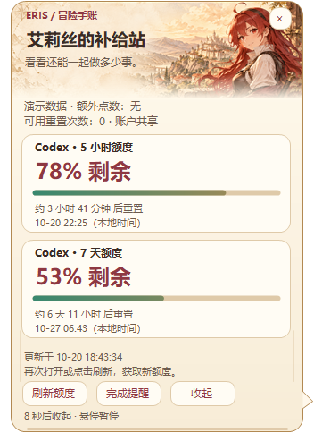

# 艾莉丝 Codex 桌宠 · 动作与语音增强版

一个运行在 Windows 桌面上的艾莉丝同人桌宠：点击她，会随机播放日语短台词和对应动作；拖动可以换位置，还可以跟随 Codex 桌面应用启动、退出。

v2.2.0 加入 **“无职转生 · 冒险手账”气泡主题**：艾莉丝同人插画、羊皮纸背景、赤红与暖金配色，额度卡片和完成记录统一排版。气泡看完自动收起，鼠标悬停暂停计时；额度通过本机 Codex 查询。

基于 [ga hing 的 roxy-pet 图集](https://github.com/yznzl/roxy-pet) 制作，保留原图像，在本地增加独立透明窗口、语音播放、动作编排和启动监测。**非 OpenAI 或《无职转生》官方项目。**

**[下载 Windows x64 发行包](https://github.com/hewenbin825-png/eris-codex-pet/releases/latest)** · [完整功能与验证记录](VALIDATION.md) · [素材来源与使用范围](THIRD-PARTY-NOTICES.md)

## 新气泡主题预览

| 剩余额度 | 完成提醒 | 中日语音字幕 |
| :---: | :---: | :---: |
|  |  |  |

预览由程序控件离屏渲染，额度和时间为示例数据。气泡约 8 秒后自动收起，悬停暂停计时；右键“气泡外观”可在“无职转生 · 冒险手账”和“简洁米白”之间切换。

## 它能做什么

| 功能 | 使用方式与作用 |
| --- | --- |
| 点击互动 | 单击角色身体，从三句台词中随机选择；相邻两次不重复，让桌面互动有变化。 |
| 台词对应动作 | 每句台词固定绑定一个动作，音频与动画从同一触发点开始，动作时长与音频匹配。 |
| 魔法喵 | “请教艾莉丝魔法喵”使用原图集中双手举起两侧头发的双马尾动作，句尾眨眼。 |
| 桌面伴随 | 透明、置顶的小窗口；按住拖动可移动位置，拖动不会误触语音。 |
| 随 Codex 启停 | 可选安装启动监测器；登录 Windows 后待机，检测到 Codex 桌面应用后启动桌宠，应用完整退出后约 4–6 秒关闭桌宠。 |
| 任务完成提醒 | 可选接入 Codex `notify`，确认是主任务的 `agent-turn-complete` 后播放完成台词和动作。子智能体完成保持安静，不触发动作、音效、字幕或完成记录。 |
| 剩余额度气泡 | 右键“剩余额度与重置时间”，显示剩余百分比、进度条、重置倒计时及更新时间；读取完成后 8 秒自动收起。 |
| 完成提醒气泡 | 右键“任务完成提醒记录”，显示最近 12 条实际完成提醒、时间、对应台词和当前播放状态；8 秒自动收起，悬停可慢慢查看。 |
| 语音字幕气泡 | 播放原声时显示中文台词与日文字幕；跟随角色移动、自动收起、悬停暂停计时，右键可禁用。 |
| 气泡外观 | 右键“气泡外观”可选择“无职转生 · 冒险手账”或“简洁米白”，选择会保存。主题气泡轻微淡入淡出，系统关闭菜单动画时省略动画。 |
| 右键菜单 | 可以指定台词试听、调音量、调大小、静音、显示/隐藏、退出。静音时动作继续。 |
| 防止声音重叠 | 播放中忽略新的点击；完成事件最多等待播放一次；通知端按回合标识去重。 |

这个工具主要提供桌面陪伴、点击反馈，以及可选的完成提醒。它不参与 Codex 推理，也不替代任务结果检查。

## 动作预览

GIF 为动作预览，声音需在本地运行后播放。

| 魔法喵 · 举双马尾 | 特别待遇 · 傲娇 | 出发吧 · 起跑 |
| :---: | :---: | :---: |
|  |  |  |

| 完成了 · 笑着点头 | 太好了 · 举拳跳跃 |
| :---: | :---: |
|  |  |

“魔法喵”按原作举双马尾的姿势选择现有帧；其他动作是适合台词的 Q 版编排，不是原作镜头的逐帧重制。

## 快速开始：只用桌宠

1. 到 [Releases](https://github.com/hewenbin825-png/eris-codex-pet/releases/latest) 下载 `eris-codex-pet-v2.2.0-windows-x64.zip`。
2. **先完整解压**到一个当前用户可写的文件夹，再双击 `Start.cmd`。
3. 单击角色听语音、看动作；按住角色可以拖动。
4. 右键角色或系统托盘图标，选择“退出动作助手”；也可双击 `Stop.cmd`。

独立运行需要 Windows x64 和 .NET Framework 4.x；已在 Windows 桌面环境实测。便携版无需 Python、无需管理员权限，也不需要付费 API。

## 会自动收起的气泡

- **换背景：** 右键角色或托盘 →“气泡外观”。默认是艾莉丝与异世界城镇的同人主题插画；也可切回简洁米白。插画固定比例绘制在顶部，正文浅底，避免文字压在头像上。[主题来源和生成提示词](THEME.md)。
- **查看额度：** 右键角色或托盘 →“剩余额度与重置时间”；也可双击托盘图标，或运行 `Open-Quota.cmd`。
- **查看完成记录：** 右键 →“任务完成提醒记录”，或运行 `Open-Reminders.cmd`。只展示桌宠收到的完成提醒，不把菜单试听计入记录，不展示任务实时进度。
- **自动收起：** 额度与提醒气泡默认显示 8 秒，底部显示剩余秒数；鼠标移入暂停，移开后接着计时。额度读取完成后重新留足 8 秒。可点击 ×、“收起”，或右键“收起所有气泡”立即关闭气泡。
- **跟随角色：** 气泡有圆角和指向角色的小尾巴，无系统标题栏、不抢键盘焦点；拖动艾莉丝时一起移动，并尽量保持在当前屏幕内。每次显示一种气泡，打开另一种或播放字幕时替换当前气泡。随时可从右键菜单重新打开。
- **字幕：** 点击或任务完成时随原声出现；静音时也显示。保留至少 8 秒，且不少于语音时长加 2 秒；悬停暂停计时。取消右键“显示语音字幕气泡”可关闭并记住选择。字幕沿用已有短片段标注，日语转录并非逐字人工校订。

额度气泡需要本机已安装并登录 Codex CLI（优先使用 Codex 桌面版附带的 CLI）。打开时刷新，15 秒内再次打开复用刚才的结果，也可手动刷新；没有持续轮询，收起后已开始的一次查询会完成且不会重新弹窗。只查询额度，不创建聊天任务、不消耗重置次数；额外点数不代表订阅额度。

周期和数量来自接口，**不固定假定“5 小时＋7 天”**。只返回周窗口时只显示周窗口；字段缺失显示“未提供”；网络失败保留上次成功结果并标记“已过期”，不会把未知显示成 100% 或 0%。重置时间经过后会等待新读数，不自行恢复为满额。

当前用户登录的本机 Codex 账户是数据来源；API key 模式、CLI 未登录或未提供额度信息时会提示无法读取。额度通常为账户共享，并非某个聊天单独拥有。窗口仅查看额度，无购买、账号登录、充值、重置操作。

## 可选：接入 Codex 自启和完成通知

需要 Python 3.11 或更新版本。脚本优先使用 `ERIS_PYTHON` 指定的解释器，其次查找 Codex 随附 Python，最后使用系统的 `py -3`。找不到时会说明缺少的环境，不会自动下载或安装软件。

1. 在解压目录双击 `Install-Codex.cmd`。
2. 安装到 `%USERPROFILE%\.codex\pets\eris\voice`；设置了 `CODEX_HOME` 时使用该目录。
3. 在 Codex 的个人菜单中选择“隐藏虚拟宠物”，避免原生桌宠与增强版同时显示。
4. 等正在进行的工作结束后，完整退出并重新打开 Codex，以便重新加载通知配置。
5. 发送一个简单请求，等回复结束，观察艾莉丝是否自动播放完成台词。手动菜单试听不等于通知联动成功。

安装会备份原 `config.toml`，只替换根级 `notify` 项，保留原通知命令的转发；还会创建当前用户启动文件夹里的 `Eris Codex Voice.lnk`。**它不修改 Codex 安装文件。** 已有同名安装、被改过的配置或不支持的通知写法会使脚本停止，避免覆盖原有设置。

监测器每约 2 秒检查一次本机 Codex 桌面进程。当前识别 Windows 应用包路径 `WindowsApps\OpenAI.Codex_*\app\ChatGPT.exe` / `Codex.exe`，不会把普通 `codex.exe` CLI 当作桌面应用。其他安装布局、macOS 和 Linux 不在当前验证范围。

临时退出桌宠后，监测器不会在同一次 Codex 会话中不断重启它；下一次打开 Codex 时恢复。不过，如果完成通知随后到达，通知入口仍可再次启动桌宠。希望只保留动作、保持安静时，选择“静音（动作继续）”。

## 关闭与撤销接入

- 临时关闭：右键“退出动作助手”或运行 `Stop.cmd`。
- 撤销 Codex 接入：运行 `Uninstall-Codex.cmd`，恢复原通知设置、移除本项目启动快捷方式并停止助手。
- 撤销后保留安装文件和备份，便于检查与恢复；若要重新安装，先将保留的 `pets\eris\voice` 文件夹另存备份。
- 需要恢复原生桌宠时，在 Codex 中选择“显示虚拟宠物”。

使用自定义 `CODEX_HOME` 的用户应在安装和撤销时保持该环境变量一致。

## 已验证和仍需验证的部分

**已验证：** 真实鼠标点击、随机台词变化、三组点击动作；五组动作/音频时长及帧边界；200 次随机选择不连续重复；透明窗口绘制；监测器检测到正在运行的 Codex 并实际启动桌宠；原生桌宠通过菜单隐藏并保存。v2.0.1 另完成两轮真实桌面任务：回复结束后自动播放完成语音和动作，事件散列、助手返回码、播放记录和用户听感相互核对通过。

**仍待真实流程确认：** 重新登录 Windows 后的启动、完整退出并重新打开 Codex 的全过程。当前完成通知结果适用于本机 Windows 桌面版，其他机器仍应按说明验收。详见 [VALIDATION.md](VALIDATION.md) 与 [两轮真实任务记录](completion-validation.json)。

v2.0.1 修复了 Windows 通知并发时在加锁前读取锁文件造成的 `PermissionError`。现在先获得锁再去重，助手成功接收信号后才记录回合；启动失败不会提前消耗去重名额。播放记录还包含静音状态、音量和音频 API 完成状态，便于区分静音动作与实际播放调用。

## 从 v2.0.x / v2.1.x 更新到 v2.2.0

便携使用者完整解压新版后运行 `Start.cmd`。已接入 Codex 的用户先备份安装目录，退出桌宠并等待旧进程结束，再复制新版 `ErisVoice.exe`、`ErisVoice.cs`、`ErisUsage.cs`、`ErisPanels.cs`、`ErisSkin.cs`、`ErisPanelTests.cs`、`bubble-eris-adventure.png`、`THEME.md`、`build.py`、`setup_codex.py`、`Open-Quota.cmd`、`Open-Reminders.cmd`、`voice-sources.json` 到原安装目录。通知入口同时更新 `notify.py`、`notify_route.py`、`notify_scope.py`，以启用子智能体过滤。字幕兼容早期的 `来源与截取.json` 文件名，缺失字幕索引时语音和动作仍可运行。

保留 `settings.json`、`integration.json`、`runtime/` 和 `backups/`，无需重新安装接入或修改 `config.toml`。新增字幕开关在旧设置中缺省为开启。重新运行该目录的 `ErisVoice.exe`；若程序被占用，等待旧进程结束后再复制。

目前没有接入 Codex 的“运行中 / 等待输入 / 失败”等内部状态；音画同步使用同一触发时钟，具体声音延迟仍受系统音频设备影响。

## 从源码构建

下载仓库源码后双击 `Build.cmd`，或使用 Python 3.11+ 运行：

```powershell
python build.py
```

构建脚本校验 `resources.zip` 内每个文件的 SHA-256，解出 `assets/` 和 `audio/`，调用本机 .NET Framework 的 `csc.exe` 编译两个程序，并执行自检。不会访问网络。

```powershell
python test_integration.py
python test_notify_concurrency.py
python test_notify_scope.py
```

第一项测试在临时目录中验证安装/撤销、配置保留、通知转发和失败后重试；外部进程与启动快捷方式操作使用模拟。第二项使用真实 Windows 子进程和文件字节锁，验证持锁等待、12 条重复通知只触发一次、6 个不同回合分别送达；助手信号仍为模拟，不播放语音、不改变本机 Codex。

第三项检查主任务、子智能体、内部审查任务、未知来源、旧数据库结构和会话元数据回退；模拟助手信号，确认子任务不会产生任何桌宠完成反馈，主任务仍只提醒一次。

| 文件 | 用途 |
| --- | --- |
| `ErisVoice.cs` | 透明窗口、鼠标互动、音频播放、动作时序与托盘菜单。 |
| `ErisPanels.cs` / `ErisUsage.cs` | 信息窗口、字幕、只读额度客户端和数据缓存。 |
| `ErisSkin.cs` / `bubble-eris-adventure.png` | 气泡主题、同人插画背景、手账卡片与淡入淡出。 |
| `ErisPanelTests.cs` | 额度边界、缓存、隐私字段、提醒筛选、多屏摆放和控件离屏渲染检查。 |
| `ErisCodexStartup.cs` | 跟随 Codex 桌面进程启动和退出的监测器。 |
| `motions.json` / `settings.json` | 台词与帧的对应关系、默认音量和大小。 |
| `notify.py` / `notify_route.py` / `notify_scope.py` | 主任务来源检查、完成通知筛选、去重及原通知转发。 |
| `setup_codex.py` | 可选通知/启动接入，配置备份与撤销。 |
| `resources.zip` | 原图集转换的 PNG 和五段短语音；来源见素材说明。 |

## 本地数据与素材说明

语音、动画和字幕本身离线运行，不使用全局鼠标钩子，不采集键盘或屏幕。打开额度窗后，通过已安装的官方 CLI 以标准输入输出调用 `initialize`、`account/rateLimits/read`；联网查询及登录状态由 Codex 自己处理。桌宠不读取浏览器凭据或 `auth.json`，不开放监听端口，不执行推理请求。

设置保存在本地 `settings.json`；运行记录位于 `runtime/`。`usage-cache.json` 只保存额度窗口、套餐标识、点数摘要、重置次数和读取时间，不保存账号 ID、邮箱、重置券 ID 或令牌。通知脚本日志仅保存事件类型、回合散列及播放结果，不保存聊天正文；已有通知命令仍按原参数转发。

完成通知只对确认的主任务生效。来源从通知元数据或本机 Codex 的线程数据库只读查询；必要时仅检查对应会话文件第一行的元数据。子智能体、内部审查任务和无法确认来源的通知均保持安静，不发送给动作助手、不排入待播队列，也不写入完成提醒列表。无法确认来源只记诊断原因，后续通知可重新检查；不扫描聊天正文来猜测任务类型。

发布包不包含个人 Codex 配置、聊天记录、运行日志、安装状态、账号凭据或本机路径记录。

图集作者为 **ga hing**，来源为 [yznzl/roxy-pet](https://github.com/yznzl/roxy-pet)，适用作者的个人、非商业使用范围；分享须保留署名与来源。原声音频片段及角色相关权利归原权利人。完整归属和引用见 [THIRD-PARTY-NOTICES.md](THIRD-PARTY-NOTICES.md)，本仓库不将全部第三方素材声明为 MIT 授权。

## 开源交互参考

参考 [PetLimitBars](https://github.com/yono-code/PetLimitBars) 的剩余额度条、手动刷新与数据来源提示，以及 [TonyNa-code/desktop-pet](https://github.com/TonyNa-code/desktop-pet) 的跟随字幕气泡、悬停延时和可收起的小窗口。这里只借鉴交互思路，没有复制这两个项目的程序、角色或资源。额度协议采用 [Codex App Server 官方文档](https://learn.chatgpt.com/docs/app-server) 的只读接口。

v2.2.0 另参考 [valerieliang/desktop-pet](https://github.com/valerieliang/desktop-pet) 的可替换气泡背景与图片失效回退思路；背景插画由内置 imagegen 生成，角色意象参考[动画官方角色页](https://mushokutensei.jp/character/)，没有复制其他桌宠项目的美术资源。
